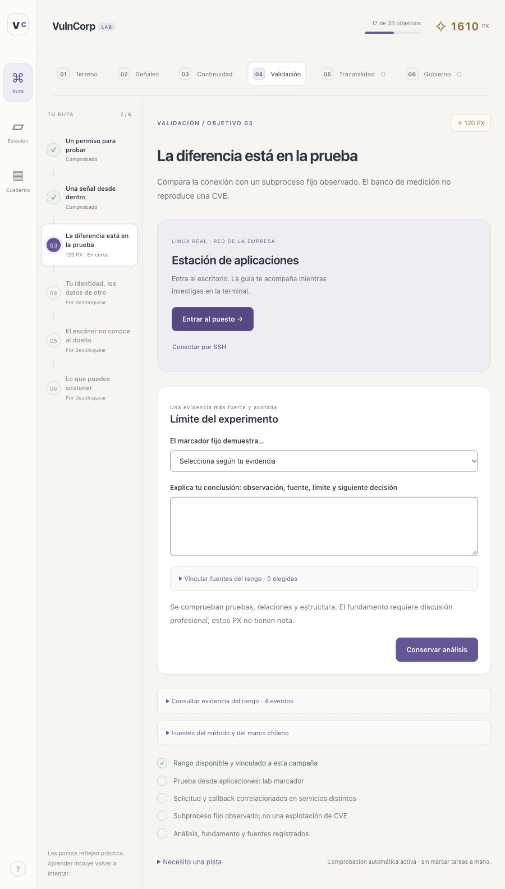

# VulnCorp LAB · Operación continuidad

Un laboratorio de gestión de vulnerabilidades que se juega dentro de una empresa ficticia. Un objetivo a la vez: investigar en un escritorio Linux real, reunir evidencia, decidir con el dueño y demostrar que una medida protege sin interrumpir el servicio.



**33 desafíos · 6 zonas · noVNC + SSH · Syft + Grype + ZAP · IA local en CPU.** La ruta se desbloquea con resultados comprobados. Los puntos son formativos: no hay notas intermedias ni clasificación por velocidad.

| Zona | Lo que debes conseguir |
|---|---|
| Terreno | Reconstruir la función del servicio, observar exposición y comparar dos perspectivas de red. |
| Señales | Generar inventarios reales, escanear, comprobar aplicabilidad e impugnar errores del proveedor. |
| Continuidad | Comparar dos dueños, revisar una inferencia local, comprometer una cartera y verificar su efecto. |
| Validación | Contrastar callback y ejecución acotada, probar autorización entre clientes y comparar con ZAP. |
| Trazabilidad | Reconstruir eventos, mapear ATT&CK y probar autorización, revocación y continuidad. |
| Gobierno | Crear una matriz de controles, ensayar reportes OIV, proponer excepciones y revisar IA sobre pruebas actuales. |

## Empezar

Equipo de referencia: **16 GB RAM, sin GPU**, Docker con **8 GB asignados**, Compose **2.24.4 o superior**, navegador y 40 GB libres recomendados. La primera preparación necesita Internet. Las estaciones del juego quedan en redes internas.

```bash
git clone https://github.com/vtomasv/vulncorp-mission-lab.git
cd vulncorp-mission-lab
./lab.sh doctor
./lab.sh prepare-game
```

Windows PowerShell: `.\lab.ps1 doctor` y `.\lab.ps1 prepare-game`. Abre [el laboratorio local](http://localhost:8095). Elige **Entrar al puesto** para noVNC o **Conectar por SSH** para tu terminal. Ejecuta `lab iniciar`; ambos accesos registran la misma evidencia y progreso. El usuario es `student`, se autentica por llave y no usa contraseña. El [par de entrenamiento, incluida su privada](training/ssh/README.md) está publicado también en la interfaz.

En sesiones siguientes usa `./lab.sh up` o `.\lab.ps1 up`. `down` detiene este proyecto y conserva progreso, bases y modelos. La [guía de inicio](docs/INICIO.md) explica cada paso.

## Lo que ocurre de verdad

Puedes entrar al mismo puesto de análisis por noVNC o con `./lab.sh ssh` / `.\lab.ps1 ssh` desde tu terminal. La plataforma publica web en `127.0.0.1:8095` y un reenvío SSH fijo hacia análisis en `127.0.0.1:2222`. Desde análisis se entra por SSH a soporte y aplicaciones, que no publican puertos al host. El escritorio VNC permanece interno. Cada puesto tiene una perspectiva de red distinta. Syft y Grype trabajan con archivos reales copiados de las imágenes del caso; el alcance parcial se conserva en el reporte.

Los servicios registran las solicitudes que reciben. Los agentes de los puestos firman los resultados de acciones acotadas y el verificador los vincula con la campaña. Un clic, una reflexión o un reporte subido manualmente no acreditan una ejecución. El cierre de la primera etapa exige **403 en exportación + transacción completada después de la medida + residual con ambas referencias**.

ZAP se inicia bajo demanda con `./lab.sh webscan-on` (Windows: `.\lab.ps1 webscan-on`) y se detiene con `webscan-off`. Solo analiza pasivamente cuatro solicitudes fijas del rango interno. La API vulnerable/corregida, el colector y el marcador fijo son servicios de entrenamiento; el marcador no reproduce Log4Shell.

La IA usa Ollama y Qwen3 1.7B local, con CPU, fuentes recuperadas y revisión humana. No obtiene autoridad para ejecutar cambios o aceptar riesgos. Los cálculos de riesgo y SSVC son deterministas.

## Para enseñar y extender

- [Replanteamiento del juego](docs/REPLANTEAMIENTO_JUEGO.md): campaña, criterios y extensión.
- [Uso docente: tres jornadas de siete horas](docs/DOCENCIA.md): trabajo cognitivo y discusión, fuera de la interfaz del jugador.
- Guías paso a paso de [Terreno](labs/01-superficie/ESTUDIANTE.md), [Señales](labs/02-evidencia/ESTUDIANTE.md) y [Continuidad](labs/03-priorizacion/ESTUDIANTE.md).
- Nuevas guías de [Validación](labs/04-validacion/ESTUDIANTE.md), [Trazabilidad](labs/05-trazabilidad/ESTUDIANTE.md) y [Gobierno](labs/06-gobierno/ESTUDIANTE.md), con cuadernos y orientaciones del instructor.
- [Continuación docente 4–6](docs/CONTINUACION_4_6.md): resultados, precondiciones, fuentes y límites de los talleres.
- [Propuesta de misión PHP2Shell](docs/PROPUESTA_PHP2SHELL.md): continuidad para IA, remediación y operación, con fuentes primarias, pruebas y criterios de avance. Es un diseño futuro, aún no implementado.
- [Acceso SSH y credenciales de práctica](docs/SSH.md).
- [Arquitectura y confianza de la evidencia](docs/ARQUITECTURA.md), [IA local](docs/IA_LOCAL.md), [validación y límites](docs/VALIDACION.md), [soluciones](docs/SOLUCIONES.md).
- [Hechos reales y fuentes](docs/CASOS_Y_FUENTES.md), [licencias](NOTICE.md).

El catálogo `data/campaign.json` define zonas, requisitos, puntos, pasos y pistas. Para ampliar la duración se agregan desafíos con su comprobación en `app/game.py`; la navegación deriva del catálogo. No se agregan menús de clases al jugador.

## Alcance

Es una instalación **individual y local**, con datos y empresas ficticias. El índice `4 × L × impacto máximo` es una política docente ordinal; no es porcentaje ni fórmula normativa. Los controles y referencias MITRE/ISO/leyes requieren interpretación y evidencia de alcance. La plataforma comprueba resultados, relaciones y restricciones; **no califica automáticamente el criterio profesional**.

Los límites configurados apuntan al equipo de 16 GB. La validación funcional disponible se ejecutó en ARM64 con más RAM; falta el piloto en un equipo físico de 16 GB y la validación de Windows. No es un sistema de examen resistente al propietario administrador de Docker ni un servicio multiusuario de producción.

Autor: **Tomás Vera · vtomasv**. Código y material original bajo MIT.
