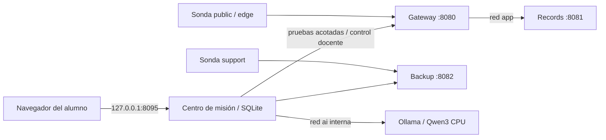

# Arquitectura y límites de confianza



Tres targets, un plano de gestión. El diagrama muestra relaciones relevantes; mission también tiene acceso a app para salud y reset de records. No reenvía IP entre redes ni recibe el socket de Docker.

## Redes

| Red | Miembros principales | Egreso |
|---|---|---|
| ui | solo mission; publicación loopback al host | Bridge normal necesario para publicación en Docker Desktop; no compartido con targets o IA |
| edge | gateway, mission, sonda public | `internal: true` |
| app | gateway, records, mission | `internal: true` |
| support | backup, mission, sonda support | `internal: true` |
| ai | mission, ollama | `internal: true` |
| feeds | Grype durante escaneo; Ollama solo durante preparación | base/descarga de pesos; Ollama pierde esta conexión al recrear desde base |

Solo mission publica un puerto al host, enlazado a loopback. Su red ui usa un bridge normal para que Docker publique el puerto; no se comparte con targets u Ollama. Todos los targets ejecutan un usuario sin privilegios, filesystem de solo lectura y capacidades eliminadas. No hay `privileged`, `network_mode: host` ni montajes del socket de Docker. La ausencia de egreso se exige a los targets y al motor de IA, no al plano de gestión.

El plano de gestión es una herramienta docente de confianza. Los endpoints `/_control` de targets usan una llave **sintética y pública**, exclusivamente para orquestación del caso. No constituyen una frontera frente al alumno que administra Docker ni un mecanismo de seguridad de producción. El gateway no reenvía rutas arbitrarias: solo export y transaction.

## Datos

- `mission_state`: SQLite, decisiones, notas, controles, inferencias y revisiones. Sobrevive a `down`.
- Targets: estado intencionalmente efímero. Reiniciar devuelve fallas iniciales. La bitácora nunca se reescribe para fingir que una prueba antigua es actual.
- `ollama_models`: pesos descargados; persisten aunque el proceso se detenga.
- `grype_cache`: base con metadatos y fecha; no se confunde con el expediente curado.
- `artifacts/`: imágenes exportadas, SBOMs, reportes y expediente. Ignorado por Git.

## Funciones y fallas

| Ruta | Estado inicial | Medida reversible |
|---|---|---|
| gateway `/api/transaction` | Completa una operación usando records. | Debe seguir funcionando tras restringir exportación. |
| gateway `/api/export` → records `/export` | Sin autenticación; expedientes ficticios. | Restricción de ruta pública; raíz en records sigue pendiente. |
| gateway `/api/diagnostics` | Topología publicada. | Retirar la ruta pública. |
| backup `/catalog` | Llave compartida sintética. | Rotación; llave anterior rechazada. |

Backup es un catálogo: **no** implementa borrado ni restauración en estas tres clases. Los costos y tiempos de ventanas son supuestos docentes, no retrasos artificiales de los contenedores.

## Qué no se presupone

Contenerización no equivale a una máquina virtual de alta seguridad. El dueño del host controla contenedores, código y datos; esta experiencia no pretende resistir a un alumno administrador malicioso. No montar carpetas de usuario, credenciales cloud ni datos reales. Los endpoints públicos del caso son públicos **dentro de la red simulada**; no se publican a Internet.

No hay dependencias runtime de Python de terceros en el aula de práctica. Los paquetes legacy se instalan con hashes solo en la etapa records y no se importan por el servicio. Se estudia inventario y aplicabilidad sin ejecutar sus exploits.

## Figura didáctica y recursos del navegador

La mesa de comparación de contexto es una **maqueta conceptual**, no un escáner ni una representación física de Docker. El lector recorre tres expedientes; la referencia de F-02 conserva CVSS y L mientras cambia el impacto del cliente. Los valores se obtienen del dossier del caso y se rotulan como referencia docente; explorar la figura no guarda una decisión, no cambia el cliente del expediente ni modifica los targets.

La figura contiene 50 sólidos. El generador usa el kit Anatomy bajo MIT y comprueba soporte y orden de profundidad en distintas posiciones. El navegador recibe SVG preconstruido: no requiere WebGL, GPU, CDN ni librerías externas. Solo anima mientras cambia de posición y está visible; respeta movimiento reducido. La comparación en secuencia se inicia por elección del estudiante y no altera su trabajo.

Solo para mantener la ilustración, con Node instalado en el equipo de desarrollo:

```bash
node scripts/build-context-figure.mjs --audit
```

La CI también ejecuta ese generador. Node sigue sin ser requisito para alumnos; la figura se distribuye construida en `web/context-figure.js`.
