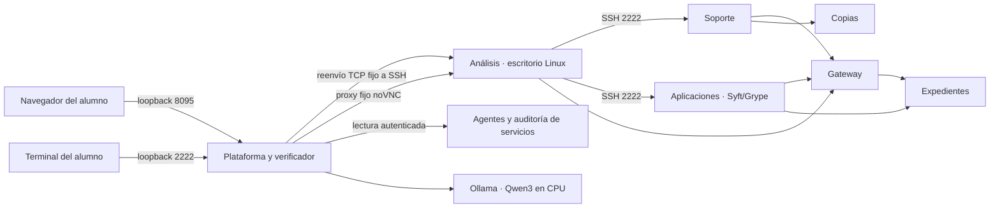

# Arquitectura de la campaña

## Segmentación efectiva

| Componente | Redes | Alcance esperado de los tres targets |
|---|---|---|
| Análisis | edge | gateway |
| Soporte | edge, support | gateway y backup |
| Aplicaciones | edge, app | gateway y records |
| Gateway | edge, app | entrada y dependencia de expedientes |
| Records | app | sin publicación al host |
| Backup | support | sin publicación al host |
| Plataforma | ui, edge, app, support, ai | plano de gestión de confianza |
| Ollama | ai | sin puerto publicado; red interna |

edge/app/support/ai son `internal:true`. Los puestos no tienen salida a Internet ni capacidades NET_ADMIN/NET_RAW. Dos interfaces en un puesto no lo convierten en router. La plataforma es el plano de gestión, con acceso deliberado a los servicios para verificarlos; no debe confundirse con una estación del estudiante.

La plataforma publica `127.0.0.1:8095` para web y `127.0.0.1:2222` para un reenvío TCP de destino fijo a workstation:2222. Docker no publica puertos de un contenedor conectado únicamente a redes internas; el reenvío permite mantener análisis solo en edge. SSH se autentica y cifra entre el cliente y sshd de análisis. noVNC reenvía HTTP/WebSocket únicamente a workstation:6080. No hay puertos publicados de soporte/aplicaciones, socket Docker, acceso privilegiado general ni selección arbitraria de destino en los proxies. La preparación de bases/modelos usa servicios distintos con egreso y retira la red temporal de Ollama.

## Quién puede acreditar qué

El usuario de práctica es **student, UID 1000**. El agente del puesto corre separado y admite acciones fijas mediante un socket Unix local: identidad, conectividad, inventario, escaneo, revisión, consulta y restricción. Los procesos de herramientas corren con UID 1000. No acepta rutas, hosts o comandos arbitrarios suministrados por el alumno.

Cada instalación genera secretos aleatorios en un volumen, legibles por el plano educativo y el agente, fuera del acceso de student. Los resultados de acciones se guardan en un diario privado y se firman HMAC. El endpoint remoto permite leer, no ejecutar. La identidad firmada enumera todas las interfaces del puesto; así se atribuyen correctamente solicitudes de una estación con dos redes.

Los targets registran solicitudes, IP de origen real, ruta, hora, estado HTTP y copia de la respuesta. El verificador acepta observaciones cuya IP corresponde a una interfaz verificada del puesto. Las pruebas del antiguo endpoint de gestión `/api/probe` conservan valor histórico, pero no acreditan estos objetivos.

El verificador filtra pruebas por inicio de campaña, aplica requisitos y concede cada premio una sola vez. SQLite conserva campañas, activaciones, observaciones y premios. Repetir una comprobación no duplica PX. Las observaciones auténticas hechas antes del desbloqueo pueden reutilizarse dentro de la misma campaña; no se finge que el alumno volvió a ejecutar algo.

## Llave de alumno y llaves privadas de la instalación

`training/ssh/vulncorp_student_ed25519` y su `.pub` forman un par compartido **intencionalmente público**. La interfaz ofrece ambas descargas mediante dos rutas exactas; no existe un servidor de archivos arbitrarios. Solo la llave pública se autoriza en sshd de análisis, desde un archivo de solo lectura fuera del hogar del alumno. El usuario es student; contraseña, acceso root y forwarding están deshabilitados.

La llave interna análisis → soporte/aplicaciones se genera por instalación y conserva su privada en el hogar de análisis. Las privadas de servidor y secretos HMAC permanecen en volúmenes privados. No son el par público del alumno ni se descargan desde la interfaz. La identidad HMAC del agente permite mostrar la llave pública y huella del servidor de análisis.

Ambos accesos ejecutan herramientas como UID 1000 en la misma red. El verificador acredita origen y resultados, no el protocolo de entrada. Compartir una llave de práctica no identifica personas: cada alumno necesita su propia instalación local.

## Alcance del inventario y de los controles

Aplicaciones contiene copias reales, de solo lectura, de `/opt/legacy` de records y del runtime de mission. Son **snapshots parciales**, no el filesystem completo ni un SBOM de toda la imagen. Los dos paquetes se instalan con versión y hash fijados y no son importados por el servicio activo. Syft genera CycloneDX; Grype recibe un SBOM recién generado por el agente, no un archivo editado por el alumno. Conserva aliases, descriptor de base, hashes y reporte completo.

La medida `restrict_export` cambia realmente la respuesta del gateway. No corrige la autorización en records ni instala una regla de firewall. El cierre exige 403 desde análisis y una transacción completada posterior al cambio, restricción vigente y residual que cite ambas pruebas.

## Memoria y límites

Límites configurados: plataforma 256 MiB; tres servicios 160 MiB cada uno; escritorio 512 MiB; soporte 128 MiB; aplicaciones 1280 MiB; Ollama 4 GiB. Total de servicios del juego con IA: **6752 MiB**, más sobrecarga del motor. Referencia: Docker con 8 GiB en host de 16 GB. Una herramienta pesada y una inferencia a la vez; el agente serializa acciones por puesto.

Los puestos arrancan con un proceso raíz y capacidades limitadas para preparar hogares, cambiar a UID 1000 y ejecutar sshd/X. Los tres puestos necesitan AUDIT_WRITE para abrir terminales SSH interactivas; está verificado explícitamente. El usuario interactivo carece de esas capacidades. El árbol de archivos del contenedor es de solo lectura, con hogares y directorios temporales específicos escribibles.

Esta es una frontera pedagógica local. El administrador del host Docker puede alterar contenedores, reloj, redes, secretos y base. HMAC protege procedencia frente al uso normal del puesto; no demuestra autoría individual ni resiste al propietario administrador. Cada estudiante necesita su propia instalación. No hay cuentas ni aislamiento multiusuario de producción.
