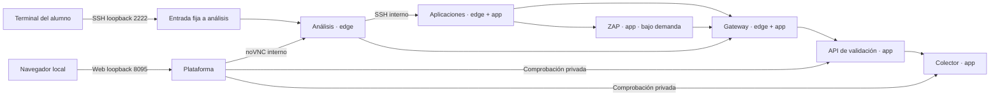

# Continuación de la campaña · talleres 4, 5 y 6

La campaña crece de 15 a **33 objetivos** y de tres a **seis zonas**, conservando IDs y PX anteriores. La interfaz habla de desafíos; la organización académica queda en las guías docentes. No hay notas intermedias ni un cronómetro para resolver el taller. Las PPT de este tramo se producirán después, con teoría y casos que preparen estas prácticas.

| Taller | Zona y seis objetivos | Producto que debe poder defenderse |
|---|---|---|
| 4 | Alcance, callback, marcador, autorización entre clientes, contraste ZAP, dictamen | Plan de prueba, matriz de acceso bidireccional y dictamen con límites |
| 5 | Simulación declarada, cronología, mapeo ATT&CK, autorización, revocación, capa | Cadena de evidencia y comparación antes/después con continuidad |
| 6 | Dueño/OIV, matriz de cinco hallazgos, calificación de incidente, reportes, excepción, revisión IA | Expediente de decisión y borradores de reporte exclusivamente locales |

## Preparar una instalación existente

Desde la carpeta del repositorio, después de actualizarlo:

```bash
./lab.sh up
./lab.sh webscan-on
```

Windows: `.\lab.ps1 up` y `.\lab.ps1 webscan-on`. La primera descarga de ZAP requiere Internet; la práctica transcurre en la red interna. `prepare-game` prepara también base Grype y pesos del modelo y arranca ZAP. `webscan-off` libera memoria cuando termina su uso. No se elimina ningún volumen para actualizar.

Continuar el primer objetivo aún pendiente. Los objetivos nuevos dependen de los anteriores; no hay un botón que otorgue resultados al alumno. Las pruebas de desarrollo usan una campaña rotulada con fixture de los primeros quince hitos; ese fixture no se presenta como evidencia de aprendizaje ni como revalidación técnica del tramo anterior.

Cada persona puede alternar noVNC y SSH. Ambos accesos llegan al mismo puesto y usan los mismos archivos, agentes y verificador. Desde análisis se salta con `ssh appdesk`. Los tokens del rango son públicos y sintéticos, igual que la llave SSH de entrenamiento.

## Lo que ocurre dentro de Docker



Los nuevos servicios no publican puertos al host, no tienen socket Docker ni privilegios generales y solo se conectan a `app`, marcada como interna. La estación de análisis no resuelve directamente `validation`, `collector` o `webscan`; puede usar la ruta autorizada de gateway. El resto de las redes originales se conserva.

La API tiene gemelos `vuln`, `fixed` y `live`. Solo `live` cambia durante los ensayos. El colector recibe conexiones reales de la aplicación; el marcador ejecuta un programa fijo sin entrada de comandos ni URLs del alumno. ZAP recibe cuatro solicitudes fijas y analiza pasivamente. El modelo local recibe pruebas actuales y una fuente legal identificada; no tiene herramientas de ejecución.

## Confianza y límites de avance

Los agentes de estación conservan recibos firmados. La plataforma consulta además logs auténticos de API y colector y relaciona sus orígenes con identidades de estación verificadas. No acepta IDs inventados, eventos de otra campaña ni de un episodio anterior para nuevos resultados. La secuencia del servidor es monotónica; no se usa como orden global entre servicios diferentes.

La comparación de controles exige tres identidades antes del cambio, confirmación del cambio y tres respuestas posteriores. Bloquear una identidad no basta si el usuario legítimo deja de operar. Los borradores, fundamentos y matriz se conservan como análisis humano: la comprobación automática verifica estructura y relaciones, no certifica criterio, cumplimiento o aceptación del riesgo.

El historial central persiste. El nuevo rango guarda episodio, controles y registros en `range_state`; reiniciar o recrear `validation` y `collector` no rompe la continuación entre sesiones. Una campaña nueva abre otro episodio. Los targets originales conservan su comportamiento previo: sus controles en memoria se reinician al recrearlos. Los hitos ganados son historia, no una certificación perpetua del estado vivo. No borrar volúmenes para actualizar.

## Equipo de 16 GB sin GPU

Los límites del conjunto habitual, con Ollama y ZAP simultáneos, suman **7.5625 GiB (7744 MiB)**. Es un presupuesto configurado, no memoria garantizada libre para el anfitrión. Se recomienda Docker con 8 GiB, al menos 40 GB libres para imágenes, cachés y pesos, y herramientas ejecutadas de forma secuencial. Detener ZAP cuando termina el contraste; no ejecutar a la vez los perfiles opcionales de escáneres de imágenes.

La validación funcional se realiza en ARM64 con más RAM física; falta el piloto en un equipo físico de 16 GB y la ejecución de PowerShell en Windows. No se declara ese piloto como realizado. El trabajo de ZAP se conserva en `zap_work`, en disco, para evitar que su base llene una carpeta en RAM. ZAP usa una imagen oficial con manifiestos amd64/arm64 fijada por digest; Ollama usa CPU y contexto acotado. No se exige una GPU.

## Profundidad para sesiones prolongadas

El núcleo guiado es deliberadamente accesible a principiantes y no se supone que copiar comandos ocupe toda la jornada. Cada guía añade predicción, matriz de casos, prueba manual de una variable, lectura de fuente primaria, contraprueba entre pares, corrección de conclusión y defensa ante el dueño. Los estudiantes rápidos amplían la investigación y refutan afirmaciones; no esperan un temporizador ni repiten comandos sin propósito.

Usar estos productos para construir posteriormente las explicaciones teóricas: fuerza de evidencia y autorización antes de Validación; tácticas/técnicas/procedimientos y causalidad antes de Trazabilidad; SGSI, autoridad del dueño, efecto significativo y bases de cálculo antes de Gobierno. No mostrar al alumno bloques o duraciones que condicionen el avance.

## Materiales

- Validación: [estudiante](../labs/04-validacion/ESTUDIANTE.md), [instructor](../labs/04-validacion/INSTRUCTOR.md), [cuaderno](../labs/04-validacion/CUADERNO.md).
- Trazabilidad: [estudiante](../labs/05-trazabilidad/ESTUDIANTE.md), [instructor](../labs/05-trazabilidad/INSTRUCTOR.md), [cuaderno](../labs/05-trazabilidad/CUADERNO.md).
- Gobierno: [estudiante](../labs/06-gobierno/ESTUDIANTE.md), [instructor](../labs/06-gobierno/INSTRUCTOR.md), [cuaderno](../labs/06-gobierno/CUADERNO.md).
- [Fuentes y analogías documentadas](FUENTES_4_6.md).
- [Verificación funcional del tramo](VALIDACION_4_6.md).
