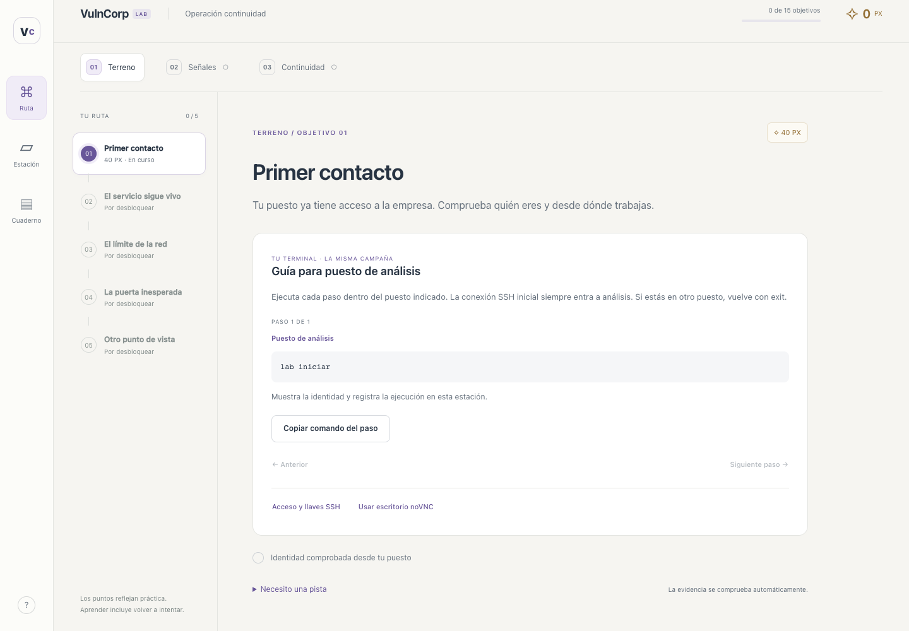

# Dos accesos al mismo puesto: noVNC y tu terminal

Puedes alternar entre el escritorio del navegador y tu cliente SSH. Ambos trabajan como **student** en el mismo contenedor de análisis, con el mismo hogar, herramientas, redes y evidencia. Son sesiones de terminal distintas: los comandos y el prompt no se reflejan de una ventana a otra. El avance pertenece a la campaña local y aparece automáticamente en la plataforma.



## Credenciales de práctica

| Dato | Valor |
|---|---|
| Usuario | `student` |
| Destino | `127.0.0.1` |
| Puerto por defecto | `2222` |
| Autenticación | Llave Ed25519 de entrenamiento |
| Contraseña SSH | No se utiliza; autenticación por contraseña deshabilitada. |
| Frase de paso de la llave | Vacía; no se solicita. |
| Par publicado | [training/ssh](../training/ssh/README.md) |

La interfaz ofrece **Conectar por SSH**, también disponible en la ayuda `?`. Allí están el usuario, las descargas de llave privada/pública, los comandos y las huellas. Pulsa **Usar mi terminal y ver los pasos** para que la ruta muestre la guía de comandos sin abrir noVNC. Puedes cambiar de acceso en cualquier momento; elegir un modo no otorga puntos. El par compartido es intencionalmente público y solo se usa en esta práctica local. Las llaves de servidor, la llave interna entre puestos y los secretos de comprobación siguen siendo privados y distintos por instalación.

## Opción recomendada: lanzador

Inicia con `up` o `prepare-game` según la [guía de inicio](INICIO.md). En otra terminal, dentro de la carpeta del repositorio:

macOS/Linux:

```bash
./lab.sh ssh
```

Windows PowerShell, con el cliente OpenSSH habilitado:

```powershell
.\lab.ps1 ssh
```

El lanzador copia el archivo de llave privada de entrenamiento (publicado por diseño) a `artifacts/ssh/student_ed25519`, limita permisos de esa copia y consulta el puerto real publicado. Obtiene la **llave pública del servidor** desde tu contenedor para verificar su identidad sin desactivar la comprobación de host. No copia llaves privadas internas. La guía PowerShell todavía requiere pilotaje en Windows.

## Opción manual: tu cliente OpenSSH

En macOS/Linux, desde la raíz del repositorio:

```bash
chmod 600 training/ssh/vulncorp_student_ed25519
ssh -i training/ssh/vulncorp_student_ed25519 -o IdentitiesOnly=yes -p 2222 student@127.0.0.1
```

Si descargaste la llave desde la interfaz, reemplaza la ruta por la de tu archivo descargado. En Windows usa preferentemente el lanzador, que prepara los permisos del archivo.

La primera conexión manual pregunta por la identidad del servidor. Compara su huella con **Servidor** en el diálogo de acceso antes de aceptar. Es normal que la huella del servidor sea distinta de la huella de la llave del alumno. Si cambia después de recrear volúmenes, vuelve a comprobarla; no desactives la verificación de host.

Si necesitas otro puerto, añade `LAB_SSH_PORT=2244` a `.env` y ejecuta `up`. El lanzador y la interfaz usan el puerto configurado. Sustituye también `2222` por `2244` en una conexión manual.

## Hacer los objetivos

Dentro de la conexión SSH:

```bash
lab iniciar
curl -s http://gateway:8080/api/transaction | jq
lab red
```

Mantén abierta la plataforma para ver el avance y leer la siguiente instrucción. Las pruebas salen del puesto de análisis, por lo que se atribuyen a la misma perspectiva que en noVNC. Si alternas de acceso, revisa el prompt: cada sesión mantiene su propio puesto actual. Repetirlas desde ambos accesos no duplica puntos.

Para entrar a los otros puestos:

```bash
ssh ops
lab red
exit
ssh appdesk
lab inventario
```

`exit` sale de la sesión actual: primero regresa desde soporte/aplicaciones a análisis; otro `exit` cierra SSH y vuelve a la terminal de tu equipo. Fuera del laboratorio no ejecutes los comandos dirigidos a gateway/records/backup: esos nombres y redes pertenecen a Docker.

Los formularios de clasificación, contexto del dueño, revisión de IA, cartera y residual se completan en la interfaz. Esta edición ofrece dos accesos técnicos; no reemplaza los formularios por una CLI.

## Segmentación

La plataforma publica en **127.0.0.1** un reenvío TCP fijo hacia el SSH de análisis. El cifrado y la autenticación se realizan con sshd del puesto; el reenvío no permite elegir otro destino. Soporte y aplicaciones no publican puertos al host. Análisis sigue conectado únicamente a edge; no se añade una red con salida a Internet. SSH no permite forwarding, túneles, acceso root ni autenticación por contraseña. La entrada cambia el medio de acceso, no la perspectiva de las pruebas.

Cada alumno ejecuta su propia instalación. Estas credenciales compartidas no identifican personas ni constituyen autenticación de un despliegue multiusuario. No uses este par de práctica en servidores reales.
